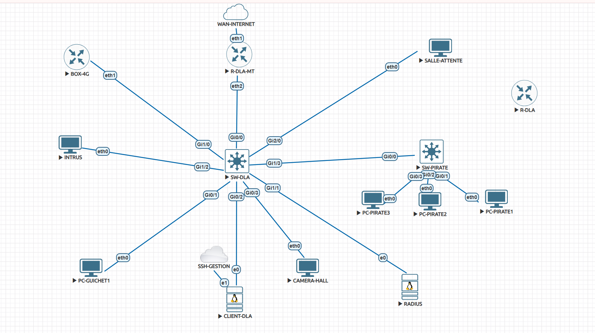

# ACX401.1 — Sécurisation de la couche 2 de l’agence de Douala

**Rendu partiel : résultats limités aux preuves jointes.** Le TP1 à la racine du dépôt est conservé. Tous les essais documentés concernent le laboratoire de Douala ; aucune preuve de Garoua n’est utilisée.

## Lecture du dossier

- [Tableau menace → mesure → preuve et bilan des quatre tests](02-preuves-TP2.2/README.md).
- [Configurations : extraits SW-DLA et limites de collecte](01-configurations/README.md).
- [TP2.3 : statut des authentifications](03-resultats-TP2.3/README.md).
- [Audit avant/après fondé sur les captures](04-audit/README.md).
- [Recommandations : trame à compléter par les étudiants](05-recommandations/README.md).
- [Captures originales fournies dans le chat](preuves/), [provenance et empreintes](preuves/manifest.json).

## Bilan à la remise

| Partie | État documenté |
|---|---|
| VLAN et trunk | VLAN et trunk observés ; conformité complète au gabarit non vérifiée. SALLE-ATTENTE, reliée à Gi2/0 sur le schéma, apparaît dans le VLAN 10 ; conformité à vérifier. |
| TP2.2 test 1 — DHCP pirate | Snooping actif sur VLAN 10, deux liaisons apprises. Attaque BOX-4G avant/après et journal de blocage non fournis. |
| TP2.2 test 2 — ARP/IP Source Guard | DAI actif sur VLAN 10 ; aucun rejet sur l’état collecté. IP Source Guard a été activé puis retiré après échec de connectivité légitime. Test non validé. |
| TP2.2 test 3 — Port Security | Limite de deux MAC et rejet d’une troisième démontrés : compteur 0 → 6, journal PSECURE_VIOLATION, deux clients joignent la passerelle. |
| TP2.2 test 4 — BPDU Guard | Journal BLOCK_BPDUGUARD, Gi1/3 err-disabled, racine inchangée. Récupération automatique à 300 s configurée mais non testée. |
| TP2.3 | 802.1X, MAB et affectation au VLAN invités non validés ; aucun journal freeradius -X fourni. |
| Configurations | Extraits SW-DLA disponibles ; export complet courant de R-DLA absent. Références exactes aux règles M1 à compléter à partir du support. |
| Recommandations | Trame laissée aux étudiants pour rédaction. |

Les captures documentent plusieurs instants successifs ; elles ne constituent pas un export final unique. La remise en état finale de Gi1/3 (shutdown et réactivation de Port Security), demandée après le test, n’est pas confirmée par une capture. La sauvegarde du laboratoire a été déclarée effectuée par l’utilisateur, sans preuve de snapshot jointe.

## Aide utilisée

Une IA a aidé à organiser le dossier, à transcrire les sorties visibles et à proposer des commandes de configuration et de diagnostic. Les manipulations et captures ont été réalisées par l’étudiant. Cette aide comprend l’analyse des sorties et le repérage des limites ; aucun pourcentage d’aide n’est affirmé. Les fonctionnalités sans preuve sont signalées comme non validées. Les commentaires et résultats doivent être relus et assumés par les auteurs.

Aucun secret RADIUS, mot de passe, clé privée ou export brut d’identifiants n’est inclus dans ce dossier. Les adresses IP/MAC présentes sont celles du laboratoire et sont nécessaires à la lecture des tests.
